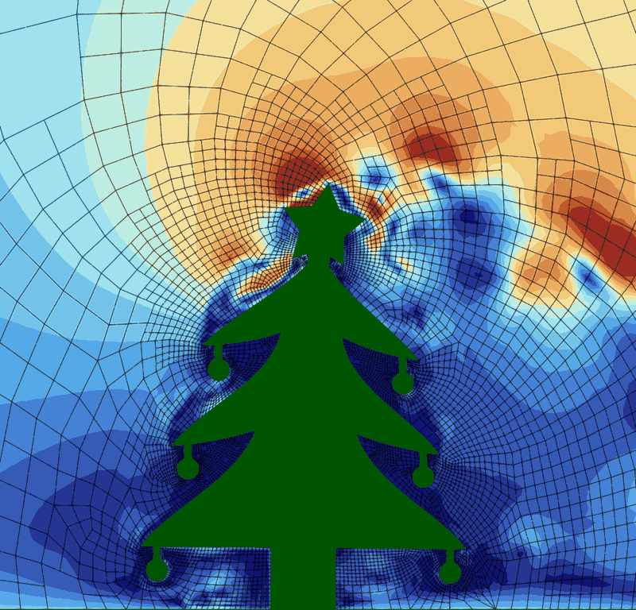

# Case README: Christmas Card 2026

<div align="center">

</div>

## Case description

Trixi.jl simulation for the Christmas card 2026: a christmas tree rocking in the wind, as a forever looping gif. Trixi.jl uses a local installation of t8code (via T8code.jl) instead of the binaries provided by `t8code_jll`.

The simulation `christmas_card_simulation.jl` runs a 5 m/s wind around a 3 m high christmas tree in a 2D wind tunnel, with adaptive mesh refinement around the tree and in its wake. The air is modeled as weakly compressible (isothermal, with a speed of sound of 50 m/s), since sound waves do not matter for the wind but would limit the time step. The simulation has three stages:
1. The flow around the resting tree develops for 0.5 s, until the pressure waves of the impulsive start have left the part of the domain shown in the gif (after about 0.3 s).
2. The mesh is deformed to the geometries `geometry/christmas_tree_*.brep` one after another, so the tree rocks in the wind with 1 Hz. After half a period, the flow in the gif (in particular the wake) follows the rocking.
3. The tree rocks for one more period, of which 32 frames are written to `out/`. Since the motion is periodic, the gif loops seamlessly from the last frame back to the first.

The geometry is created by `christmas_tree_brep.py` (see the docstring there): the frames of the rocking tree with its star and baubles as `.brep` files and the mesh of the first frame as `.msh` file. All frames have the same topology and every curve has the same parametrization in all frames, so that the mesh can be morphed from one frame to the next. The parametric coordinates of the nodes inside the fluid domain are removed from the `.msh` file, since t8code would otherwise not move them when deforming the mesh (see `strip_surface_parameters` there).

## Workflow

The `run.sh` script executes the following main steps:
* Create the geometry in `geometry/` with `christmas_tree_brep.py`, using gmsh:
  ```
  python christmas_tree_brep.py --frames 256 --periods 1.5 --height 3 --tunnel -2 3 4 --mesh-size-tree 0.11 --output-dir geometry
  ```
  The frames per period and the number of periods have to match the time stages in `christmas_card_simulation.jl`.
* Configure, build, and install t8code as shared libraries with MPI, OpenCASCADE, and Eigen (downloaded by t8code).
* Set up the Julia environment in the case folder:
  * Install the Julia packages into the case-local depot `julia_depot`. Trixi.jl and T8code.jl are used from `libs/` (see `[sources]` in `Project.toml`).
  * Configure MPI.jl to use the MPI of the `mpicc` in `PATH`, HDF5.jl to use the HDF5 in `HDF5_LIBRARY_DIR`, and T8code.jl and P4est.jl to use the local t8code, libsc, and p4est libraries (written to `LocalPreferences.toml`).
  * Precompile the packages.
* Run `christmas_card_simulation.jl` on `NUM_RANKS` MPI ranks; the frames of the gif are written to `out/`.
* Convert the frames to VTK files for ParaView with Trixi2Vtk.jl. Open `out/solution_000.pvd` in ParaView to get all frames as a time series.

The whole case takes about 35 minutes, of which the simulation takes about 30 minutes on 8 ranks of a recent workstation.

The number of MPI ranks can be set with the environment variable `NUM_RANKS` (default: 8, or the number of processors if there are fewer). The mesh has only about 6000 elements, so more ranks hardly pay off: 4, 8, and 16 ranks are 3.3, 5.7, and 6.8 times faster than 1 rank. With OpenMPI, `NUM_RANKS` must not exceed the number of physical cores.

## Dependencies

### Fetched repositories

* `t8code` from `https://github.com/DLR-AMR/t8code`, commit `0e7153a` (branch `christmas_card_2026`).
* `T8code.jl` from `https://github.com/DLR-AMR/T8code.jl`, commit `7496923` (branch `se-post_update_26.10`).
* `Trixi.jl` from `https://github.com/sandro-elsweijer/Trixi.jl` (fork), commit `4d785ab` (branch `feature-mesh_deformation`).

### Conda environment

All other dependencies except Julia come from the conda environment of `environment.txt` (conda-forge): Python with gmsh 4.15.2, OpenCASCADE 7.9.3, MPICH, HDF5 built with this MPICH, GCC 13, CMake, and Ninja. Create it once and activate it before running the case:
```
conda create --prefix ./conda_env --file environment.txt
conda activate ./conda_env
```
t8code is built with the compilers, the MPI, and the OpenCASCADE of the environment. MPI.jl and HDF5.jl use its MPI and HDF5, and `run.sh` launches the simulation with its `mpiexec`.

Without conda, the same dependencies can be provided otherwise: `run.sh` uses the `mpicc` (and its `mpiexec`) and the `python3` (with gmsh) in `PATH` (or the Python in the environment variable `PYTHON`), and CMake has to find OpenCASCADE (or set `OpenCASCADE_ROOT` in `system_hints.sh` in the repository root). Set `HDF5_LIBRARY_DIR` in `system_hints.sh` to the directory containing `libhdf5` and `libhdf5_hl` built with the same MPI.

### Other dependencies

* Julia, version 1.13 (tested with 1.13.3, has to be in `PATH`). The Julia packages other than Trixi.jl and T8code.jl are installed in their latest compatible versions.

## Contact person:

sandro.elsweijer@dlr.de
