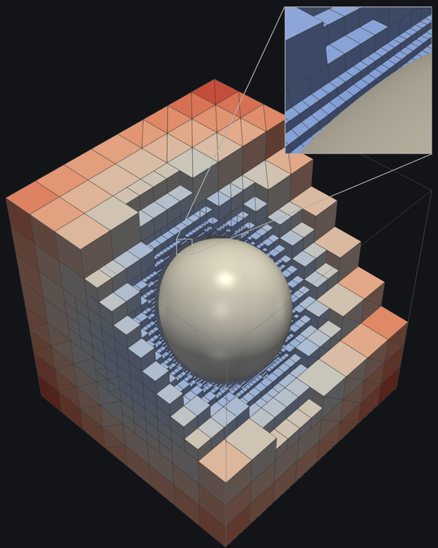

# Case README: GPU Advection Visualization


## Case description

This case produces a video (and a still image) of t8code's finite-volume advection example running on an
adaptive hybrid mesh. The example is part of
[t8code_GPU_advect_experiments](https://github.com/DLR-AMR/t8code_GPU_advect_experiments), where the element loop of the solver
is offloaded to the GPU with OpenMP `target`.

* **What is simulated:** A level-set function $\varphi$ (signed distance to a sphere of radius 0.25 around (0.6, 0.6, 0.6))
  is transported in the 3D flow field `-u 3` through the unit cube.
  The mesh is refined adaptively in a band around the interface $\varphi = 0$, and is coarsened again behind it.
* **Mesh:** The unit cube is a hybrid coarse mesh (`-e 8`) made of hexahedra, tetrahedra and prisms.
* **Result:** An MP4 video for a LinkedIn post (1080×1350, 4:5, 24 fps, 5 s, H.264/yuv420p) of the first half of the
  run, a still image and a ParaView state file (`.pvsm`) to open the same scene in the ParaView GUI.

> [!IMPORTANT]
> **The case runs on the CPU, with 10 MPI ranks.**
> It builds the advection example without offloading (`OFFLOAD_ARCH=NONE`), so it needs no GPU. It runs on the
> Teamserver with its modules, or on any Linux machine with the tools listed in [Dependencies](#dependencies)
> (see [Running without the Teamserver modules](#running-without-the-teamserver-modules)).
> The video of the case is made from the run `e8u3l4r4c01b15t1a10v100` (see [Simulation parameters](#simulation-parameters)).
>
> **An earlier video was computed on a GPU** (aac7, 1 MPI rank on 1 GPU) with different parameters.
> It is stored separately. See [GPU run on aac7](#gpu-run-on-aac7) to repeat that run (optional).
> The case and the GPU run use the same scene (cutting plane, camera, colors, texts).

## What the video shows

<p align="center">
  
  
  
</p>
<p align="center"><em>Output steps 0, 15 and 29: start, middle and end of the video (first half of the run, steps 0 … 58).</em></p>

* The mesh is cut by a diagonal plane with normal (0, 1, 1) through the path of the sphere center.
  A *crinkle clip* removes whole elements, so you see the actual elements, not cut polygons.
  The faces are drawn with their edges ("Surface With Edges").
* The elements are colored by the numerical solution $\varphi$ (blue: inside, red: outside), with a fixed symmetric
  color range of ±0.25 for all time steps.
* The light surface is the interface $\varphi = 0$ on the removed side of the plane. Therefore the half sphere sits on
  the cut face. Around it you see the band of fine elements (refinement level up to 8) as a ring on the cut face.
* The window in the lower left corner zooms (10 times) into the refinement band on the cut face at the upper left of
  the sphere. The elements become finer towards the interface like a staircase. At the start, the zoom shows hexahedra.
  Later the sphere moves into the prismatic part of the mesh, and the zoom shows prisms.
  In the zoom, the sphere is semi-transparent, so the elements behind it stay visible.
  The small frame in the main image marks the zoomed region.
* During the run, the sphere moves along a loop and is deformed by the flow. The video ends after half of the
  simulation time (output step 29 of 58). You can watch the refinement band move with the interface and the mesh coarsen
  behind it.
* The texts at the top ("t8code - adaptive mesh refinement on a hybrid mesh", "Solver loop: AMD GPU (OpenMP offload) -
  Mesh adaptation: CPU") and below the zoom ("Refinement follows interface") are the same as in the GPU video
  (option `--labels`).

### Mesh


The image on the right shows the same scene colored by element type (output step 15): hexahedra in blue, prisms in green.
The tetrahedral part of the coarse mesh is not visible in this view.
The state file contains this coloring as the hidden pipeline branch `element_type`.
To show it in the ParaView GUI, hide `mesh_crinkle_clip` and show `element_type`.

<br clear="right">

## Simulation parameters

The data set is called `e8u3l4r4c01b15t1a10v100`, after the command line options of `t8code_GPU_experiments_advect`:

| Option | Value | Meaning |
|---|---|---|
| `-e` | 8 | Coarse mesh: hybrid cube (hexahedra, tetrahedra, prisms) |
| `-u` | 3 | Flow field number 3 |
| `-l` | 4 | Minimum refinement level |
| `-r` | 4 | Number of additional adaptive levels (up to level 8) |
| `-C` | 0.1 | CFL number |
| `-b` | 1.5 | Width of the refinement band around the interface (default 1) |
| `-T` | 1 | End time |
| `-a` | 10 | Adapt the mesh every 10 time steps |
| `-v` | 100 | Write VTK output every 100 time steps (59 output steps `advection_000` … `advection_058`) |

The simulation runs with 10 MPI ranks, one OpenMP thread each (`NUM_PROCS` in `run.sh`).
The video uses output steps 0 … 29, i.e. the first half of the simulation time (`LAST_STEP` in `run.sh`).

## GPU run on aac7

The advection example was also run on a GPU of the AMD system **aac7**, as follow-up work on the course
*"Introduction to OpenMP Offloading with AMD GPUs"*, October 27–28, 2026.
The earlier GPU video was made from this run (data set `e8u3l3r4c01t1a10v25`). It used 1 MPI rank on 1 GPU and
different parameters than the case (`-l 3 -r 4 -v 25`, default band width, see step 4 below). This run is optional,
the case does not need it.

* System: HPE Cray EX with the Cray Programming Environment (CPE). PrgEnv-cray is loaded by default
  (Cray cce compiler, cray-mpich, cray-libsci). Switch toolchains with, e.g., `module load PrgEnv-amd` or
  `module load PrgEnv-gnu`.
* GPU nodes: AMD MI300A APUs (`gfx942`), CPU and GPU share the same memory.

To repeat the GPU run, build the same commit of t8code_GPU_advect_experiments (see `dependencies.json`) with offloading
enabled. All steps run **on a GPU node**, in an interactive session started with `srun` (1 node, 1 GPU).

1. Before building, load the new ROCm and use the AMD Clang compilers (needed for offloading):

   ```bash
   module unload rocm
   module load rocm-new/10.1.0
   export CC=amdclang
   export CXX=amdclang++
   ```

2. Build. On a GPU node, the offload architecture (`gfx942`) is detected automatically:

   ```bash
   cmake -S t8code_GPU_advect_experiments -B build -GNinja -DCMAKE_BUILD_TYPE=Release
   ninja -C build t8code_GPU_experiments_advect
   ```

3. Before running, enable XNACK. The kernel reads host memory directly (unified shared memory), which needs it:

   ```bash
   export HSA_XNACK=1
   ```

   Optional checks: `export OMP_TARGET_OFFLOAD=MANDATORY` aborts instead of silently falling back to the host,
   and `export LIBOMPTARGET_INFO=4` prints the kernel launches.

4. Run the executable directly in the interactive session, as a single process (no `mpirun`):

   ```bash
   cd build
   ./t8code_GPU_experiments_advect -e 8 -u3 -l3 -r4 -C0.1 -T1 -a10 -v25
   ```

   Compared to the case run, this uses minimum level 3 with 4 adaptive levels (up to level 7), band width 1, and writes
   VTK output every 25 time steps (118 output steps `advection_000.pvtu` … `advection_117.pvtu`, about 25 GB).

To make the video from the GPU run, copy the `advection_*.pvtu`/`.vtu` files to a machine with ParaView 5.11 and run
the scripts in `postprocessing/` with 11.8 steps per second (118 steps → 10 s video, 59 render processes):

```bash
bash postprocessing/make_video.sh <data_dir> <out_dir> 59 11.8 1 --inset --labels
env -u LD_LIBRARY_PATH -u PYTHONPATH /usr/bin/pvpython --force-offscreen-rendering \
    postprocessing/advect_scene.py state <data_dir> <out_dir>/advect_hybrid_cube.pvsm
```

The cutting plane and the camera fit both runs, the sphere follows the same path. Rendering the 118 steps took
about 5 minutes with 59 processes. The still image is output step 59.

The option `--labels` adds the text overlays: the title "t8code - adaptive mesh refinement on a hybrid mesh",
below it "Solver loop: AMD GPU (OpenMP offload) - Mesh adaptation: CPU", and "Refinement follows interface" below the zoom.
`run.sh` uses the same texts for the CPU run. The texts are set at the top of `postprocessing/advect_scene.py` (`LABEL_*`).
With `--subtitle=TEXT` the second line is replaced, `--subtitle=` leaves it out.

## Workflow

The `run.sh` script executes the following main steps:
* Load the module `t8code/t8code-development-gcc13-mpich`, if the module system has it. Otherwise use the tools from `PATH`.
* Configure and build `t8code_GPU_experiments_advect` from `libs/t8code_gpu_advect_experiments-src` without offloading
  (Ninja if available, otherwise Make). The project fetches its own t8code version (see `cmake/thirdparty.json` in that repository).
* Run the simulation with 10 MPI ranks in `output/simulation/` (59 output steps `advection_000.pvtu` … `advection_058.pvtu`,
  log in `advect.log`).
* Render one image for each of the output steps 0 … 29 with ParaView (30 processes in parallel), with the zoom into the
  refinement band and the texts, and encode the video with ffmpeg. Each step is shown for 4 video frames
  (6 steps per second), so the video is 5 s long.
* Write the ParaView state file.

`run.sh` reads these environment variables: `NUM_PROCS` (MPI ranks, default 10), `NUM_JOBS` (build jobs, default
`nproc`), `NUM_RENDER` (render processes, default 30) and `PVPYTHON` (default `/usr/bin/pvpython`, else `pvpython` from `PATH`).

Results in `output/visualization/`:

| File | Content |
|---|---|
| `advect_hybrid_cube.mp4` | The video |
| `advect_hybrid_cube_still.png` | Still image (output step 15) |
| `advect_hybrid_cube.pvsm` | ParaView state file (absolute paths to `output/simulation/`) |
| `frames/` | One PNG per output step |

### Visualization pipeline

`postprocessing/advect_scene.py` builds the scene. The scene parameters (plane, camera, color range, smoothing) are
at the top of the file.

* The mesh: crinkle clip of the partitioned grid, colored by the cell data `Num. Solution`.
* The interface: `Num. Solution_points` cannot be used for the contour, because it stores the constant element value on
  per-element copies of the points. Instead, the pipeline merges the points (Clean to Grid), averages the cell values to
  the points, resamples them to a uniform 256³ grid, smooths them with a Gaussian filter
  (σ ≈ 0.013, removes ripples from the jumps at hanging faces) and then extracts $\varphi = 0$.
* The zoom (option `--inset` of `advect_scene.py` and `make_video.sh`): a second camera looks from the same direction,
  10 times magnified, at the interface on the cut face at the upper left of the sphere. Its target is the outermost point of
  the intersection of the interface with the cutting plane, so it follows the sphere and its deformation.
  In the zoom, the sphere is semi-transparent (opacity 0.4) and gets more ambient light, since this side is in the shade.
  The zoom is placed in the lower left of each frame, about 190 px above the bottom edge, so that the controls of video
  players do not cover it. A frame with two connecting lines marks the zoomed region in the main image (drawn with Pillow).
  The direction of the zoomed region from the sphere is `INSET_DIRECTION` in `advect_scene.py` (option `--inset-dir=x,y,z`);
  `0.962,0.193,-0.193` gives the lower left of the sphere, as in earlier versions of the video.
  The state file contains only the main view.
* `make_video.sh` accepts `--last=N` after the render options to end the video at output step N
  (e.g. `--last=29` for the first half of a run with 59 output steps).
* The text overlays (option `--labels`, see [GPU run on aac7](#gpu-run-on-aac7)) use the Roboto font
  (`/usr/share/fonts/truetype/roboto/hinted`). The camera frames the cube so that it stays clear of the texts and the zoom.

## Dependencies

### Fetched repositories

* `t8code_GPU_advect_experiments` from `https://github.com/DLR-AMR/t8code_GPU_advect_experiments`, which in turn fetches
  `t8code` from `https://github.com/DLR-AMR/t8code`.

### Teamserver modules

`t8code/t8code-development-gcc13-mpich` (optional, see below)

### Running without the Teamserver modules

The case does not need the Teamserver modules. If the module system or the module is missing, `run.sh` and
`prepare_on_teamserver.sh` skip it, and `run.sh` takes the tools from `PATH`. It checks for `cmake`, `mpicc`, `mpicxx`,
`mpirun`, `ffmpeg` and pvpython before it starts. Tested on Ubuntu 24.04 in an empty environment
(`env -i PATH=/usr/local/bin:/usr/bin:/bin`) with the Ubuntu packages: CMake 3.28, Make (no Ninja), GCC 13.3,
Open MPI 4.1.6, ffmpeg and ParaView 5.11.2 (build of `t8code_GPU_experiments_advect` and a short simulation run).
On Ubuntu, the packages are, e.g., `cmake make g++ libopenmpi-dev openmpi-bin ffmpeg paraview fonts-roboto-hinted git`.

### Other dependencies

* **ParaView 5.11.2** from the Ubuntu package (`/usr/bin/pvpython`), started with
  `env -u LD_LIBRARY_PATH -u PYTHONPATH` so that it does not pick up libraries from the module system.
  ParaView 5.12.0-RC1 from the module system crashes (segmentation fault in `vtkExtractCells`) when the time step
  changes with a crinkle clip in the pipeline. Use 5.11.2 also to open the state file in the GUI (`/usr/bin/paraview`).
* ffmpeg with libx264.
* Pillow (Python package, included in the Ubuntu ParaView 5.11.2) and the Roboto font for the zoom and the text overlays.
* MPI version 3.0 or higher, C++ compiler supporting C++20.
* Disk space: about 69 GB for the simulation output in `output/simulation/` (59 output steps).
* Memory: each render process needs about 5–6 GB, so the default 30 render processes need about 180 GB.
  On smaller machines, set `NUM_RENDER` lower (the rendering then takes longer).

### Run time

Rendering the 30 images with 30 processes took about 6.5 minutes on the Teamserver (3–4.5 minutes per image).
The run time of the simulation with these parameters has not been measured within the case yet.

## Contact person:

johannes.holke@dlr.de
