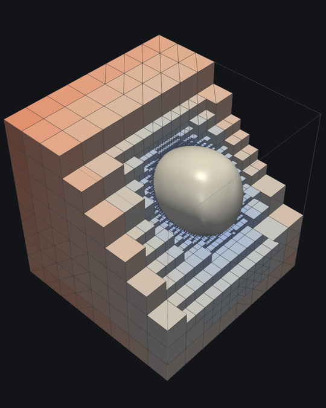
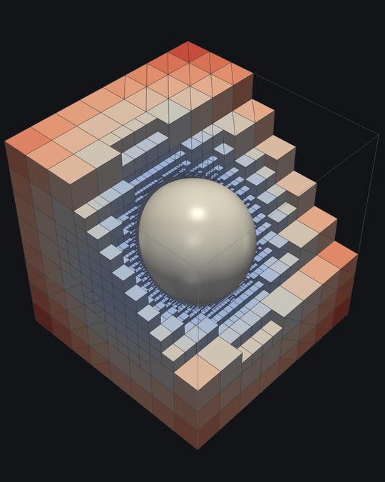
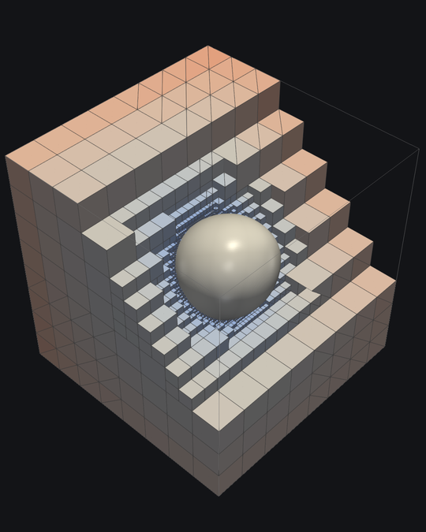
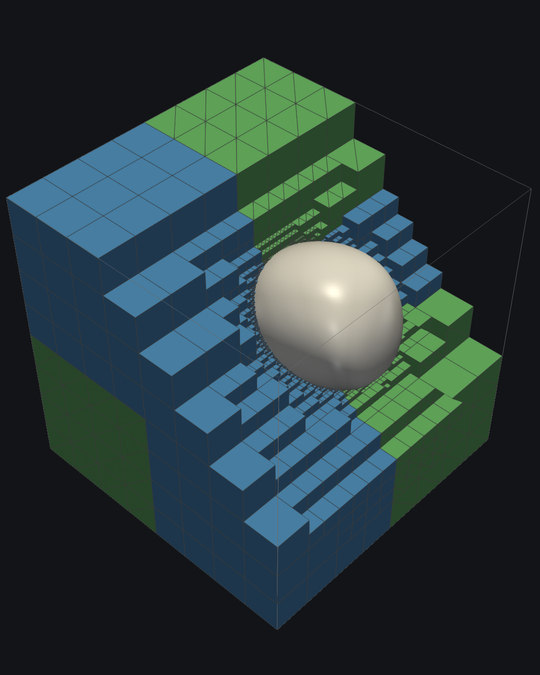

# Case README: GPU Advection Visualization



## Case description

This case reproduces a video (and a still image) of t8code's finite-volume advection example running on an
adaptive hybrid mesh. The example is part of
[t8code_GPU_experiments](https://github.com/dlr-amr/t8code_GPU_experiments), where the element loop of the solver
is offloaded to the GPU with OpenMP `target`.

* **What is simulated:** A level-set function $\varphi$ (signed distance to a sphere of radius 0.25 around (0.6, 0.6, 0.6))
  is transported in the 3D flow field `-u 3` through the unit cube.
  The mesh is refined adaptively in a band around the interface $\varphi = 0$, and is coarsened again behind it.
* **Mesh:** The unit cube is a hybrid coarse mesh (`-e 8`) made of hexahedra, tetrahedra and prisms.
* **Result:** An MP4 video for a LinkedIn post (1080×1350, 4:5, 24 fps, 10 s, H.264/yuv420p), a still image from the
  middle of the run and a ParaView state file (`.pvsm`) to open the same scene in the ParaView GUI.

> [!IMPORTANT]
> **The data of the video were computed on the CPU, with 20 MPI ranks.**
> The case does the same: it builds the advection example without offloading (`OFFLOAD_ARCH=NONE`), so it runs on
> the Teamserver, which has no usable GPU. The case run reproduces the original data of the video exactly: same element
> counts in every output step, identical solution values in the VTU files (checked for output step 59), and an
> identical rendered image of output step 30.
> The same code also runs on a GPU. See [GPU run on aac7](#gpu-run-on-aac7) for a GPU run of this example
> (with different parameters).

## What the video shows

<p align="center">
  
  
  
</p>
<p align="center"><em>Output steps 0, 30 and 55 of 60.</em></p>

* The mesh is cut by a diagonal plane with normal (0, 1, 1) through the path of the sphere center.
  A *crinkle clip* removes whole elements, so you see the actual elements, not cut polygons.
  The faces are drawn with their edges ("Surface With Edges").
* The elements are colored by the numerical solution $\varphi$ (blue: inside, red: outside), with a fixed symmetric
  color range of ±0.25 for all time steps.
* The light surface is the interface $\varphi = 0$ on the removed side of the plane. Therefore the half sphere sits on
  the cut face. Around it you see the band of fine elements (refinement level up to 7) as a ring on the cut face.
* During the run, the sphere moves along a loop and is deformed by the flow (middle image). At the end it is almost
  back at its start. You can watch the refinement band move with the interface and the mesh coarsen behind it.

### Mesh



The image on the right shows the same scene colored by element type: hexahedra in blue, prisms in green.
The tetrahedral part of the coarse mesh is not visible in this view.
The state file contains this coloring as the hidden pipeline branch `element_type`.
To show it in the ParaView GUI, hide `mesh_crinkle_clip` and show `element_type`.

<br clear="right">

## Simulation parameters

The data set is called `e8u3l2r5c01t1a10v50`, after the command line options of `t8code_GPU_experiments_advect`:

| Option | Value | Meaning |
|---|---|---|
| `-e` | 8 | Coarse mesh: hybrid cube (hexahedra, tetrahedra, prisms) |
| `-u` | 3 | Flow field number 3 |
| `-l` | 2 | Minimum refinement level |
| `-r` | 5 | Number of additional adaptive levels (up to level 7) |
| `-C` | 0.1 | CFL number |
| `-T` | 1 | End time |
| `-a` | 10 | Adapt the mesh every 10 time steps |
| `-v` | 50 | Write VTK output every 50 time steps (60 output steps) |

The simulation runs with 20 MPI ranks, one OpenMP thread each.

## GPU run on aac7

The advection example was also run on a GPU of the AMD system **aac7**, as follow-up work on the course
*"Introduction to OpenMP Offloading with AMD GPUs"*, October 27–28, 2026.
This GPU run is not part of the video. It used 1 MPI rank on 1 GPU and different parameters
(`-l 3 -r 4 -v 100`, see step 4 below).

* System: HPE Cray EX with the Cray Programming Environment (CPE). PrgEnv-cray is loaded by default
  (Cray cce compiler, cray-mpich, cray-libsci). Switch toolchains with, e.g., `module load PrgEnv-amd` or
  `module load PrgEnv-gnu`.
* GPU nodes: AMD MI300A APUs (`gfx942`), CPU and GPU share the same memory.

To repeat the GPU run, build the same commit of t8code_GPU_experiments (see `dependencies.json`) with offloading
enabled. All steps run **on a GPU node**, in an interactive session started with `srun` (1 node, 1 GPU).

1. Before building, load the new ROCm and use the AMD Clang compilers (needed for offloading):

   ```bash
   module unload rocm
   module load rocm-new/10.1.0
   export CC=amdclang
   export CXX=amdclang++
   ```

2. Build. On a GPU node, the offload architecture (`gfx942`) is detected automatically:

   ```bash
   cmake -S t8code_GPU_experiments -B build -GNinja -DCMAKE_BUILD_TYPE=Release
   ninja -C build t8code_GPU_experiments_advect
   ```

3. Before running, enable XNACK. The kernel reads host memory directly (unified shared memory), which needs it:

   ```bash
   export HSA_XNACK=1
   ```

   Optional checks: `export OMP_TARGET_OFFLOAD=MANDATORY` aborts instead of silently falling back to the host,
   and `export LIBOMPTARGET_INFO=4` prints the kernel launches.

4. Run the executable directly in the interactive session, as a single process (no `mpirun`):

   ```bash
   cd build
   ./t8code_GPU_experiments_advect -e 8 -u3 -l3 -r4 -C0.1 -T1 -a10 -v100
   ```

   Compared to the video run, this uses minimum level 3 with 4 adaptive levels (also up to level 7) and writes
   VTK output only every 100 time steps.

The scripts in `postprocessing/` also work for the output of the GPU run (copy the `advection_*.pvtu`/`.vtu` files
to a machine with ParaView 5.11). The cutting plane, the camera and the video speed are tuned for the video run, though.
With fewer output steps, choose a smaller `steps_per_second` in `make_video.sh` to keep the video length.

## Workflow

The `run.sh` script executes the following main steps:
* Load the module `t8code/t8code-development-gcc13-mpich`.
* Configure and build `t8code_GPU_experiments_advect` from `libs/t8code_gpu_experiments-src` without offloading.
  The project fetches its own t8code version (see `cmake/thirdparty.json` in that repository).
* Run the simulation with 20 MPI ranks in `output/simulation/` (60 output steps `advection_000.pvtu` … `advection_059.pvtu`, log in `advect.log`).
* Render one image per output step with ParaView (30 processes in parallel) and encode the video with ffmpeg.
  Each step is shown for 4 video frames (6 steps per second), so the video is 10 s long.
* Write the ParaView state file.

Results in `output/visualization/`:

| File | Content |
|---|---|
| `advect_hybrid_cube.mp4` | The video |
| `advect_hybrid_cube_still.png` | Still image (output step 30) |
| `advect_hybrid_cube.pvsm` | ParaView state file (absolute paths to `output/simulation/`) |
| `frames/` | One PNG per output step |

### Visualization pipeline

`postprocessing/advect_scene.py` builds the scene. The scene parameters (plane, camera, color range, smoothing) are
at the top of the file.

* The mesh: crinkle clip of the partitioned grid, colored by the cell data `Num. Solution`.
* The interface: `Num. Solution_points` cannot be used for the contour, because it stores the constant element value on
  per-element copies of the points. Instead, the pipeline merges the points (Clean to Grid), averages the cell values to
  the points, resamples them to a uniform 256³ grid, smooths them with a Gaussian filter
  (σ ≈ 0.013, removes ripples from the jumps at hanging faces) and then extracts $\varphi = 0$.

## Dependencies

### Fetched repositories

* `t8code_GPU_experiments` from `https://github.com/dlr-amr/t8code_GPU_experiments`, which in turn fetches
  `t8code` from `https://github.com/DLR-AMR/t8code`.

### Teamserver modules

`t8code/t8code-development-gcc13-mpich`

### Other dependencies

* **ParaView 5.11.2** from the Ubuntu package (`/usr/bin/pvpython`), started with
  `env -u LD_LIBRARY_PATH -u PYTHONPATH` so that it does not pick up libraries from the module system.
  ParaView 5.12.0-RC1 from the module system crashes (segmentation fault in `vtkExtractCells`) when the time step
  changes with a crinkle clip in the pipeline. Use 5.11.2 also to open the state file in the GUI (`/usr/bin/paraview`).
* ffmpeg with libx264.
* MPI version 3.0 or higher, C++ compiler supporting C++20.
* Disk space: about 12 GB for the simulation output (ASCII VTU) in `output/simulation/`.

### Run time on the Teamserver

About 11 minutes in total: building the project and t8code, about 6.5 minutes for the simulation
(2918 time steps on 20 ranks) and about 3 minutes for rendering the 60 images.

## Contact person:

johannes.holke@dlr.de
